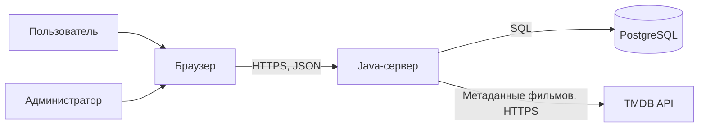
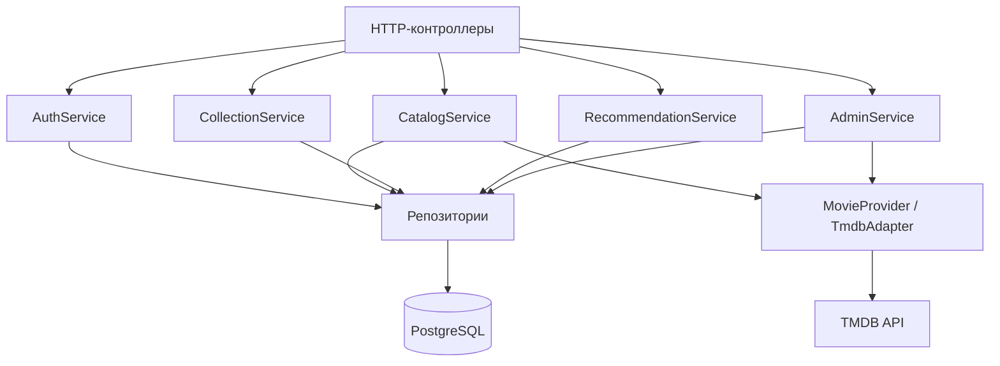
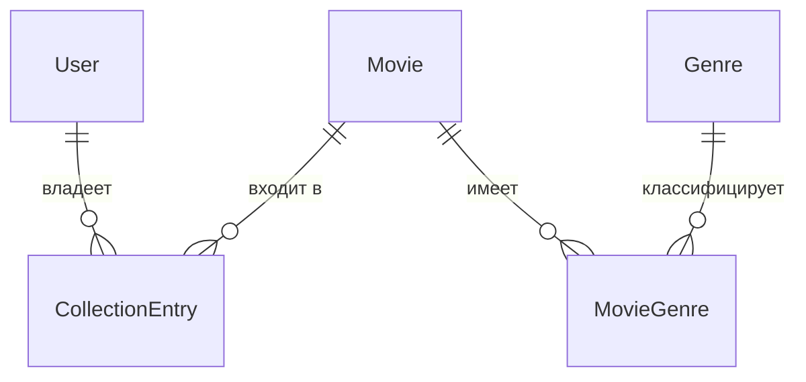

# Описание дизайна программного обеспечения

Для веб-приложения «КиноНавигатор»

Версия 0.2

Подготовил: Артём Фалько, группа 450504

Учреждение образования «Белорусский государственный университет информатики и радиоэлектроники»

19 ноября 2026 г.

## Оглавление

* [1. Введение](#1-введение)
  * [1.1 Назначение документа](#11-назначение-документа)
  * [1.2 Область применения](#12-область-применения)
  * [1.3 Определения, акронимы и сокращения](#13-определения-акронимы-и-сокращения)
  * [1.4 Ссылки](#14-ссылки)
  * [1.5 Обзор документа](#15-обзор-документа)
* [2. Обзор дизайна](#2-обзор-дизайна)
  * [2.1 Задачи стейкхолдеров](#21-задачи-стейкхолдеров)
  * [2.2 Выбранные точки зрения](#22-выбранные-точки-зрения)
* [3. Проектные представления](#3-проектные-представления)
* [4. Решения](#4-решения)
* [5. Приложения](#5-приложения)

## История изменений

| Автор | Дата | Причина изменений | Версия |
|---|---|---|---|
| А. А. Фалько | 2026-11-19 | Проектирование на основе SRS 0.2 | 0.1 |
| А. А. Фалько | 2026-11-19 | Уточнение точек зрения, схем и обоснования архитектуры | 0.2 |

## 1. Введение

### 1.1 Назначение документа

SDD определяет, как должны быть реализованы требования «КиноНавигатора» из SRS 0.2 от 25.10.2026. Документ предназначен для разработчика, тестировщика и специалиста сопровождения. Он задаёт границы компонентов, данные, интерфейсы, алгоритм рекомендаций и проверяемые системные требования.

### 1.2 Область применения

Документ охватывает первый выпуск веб-приложения: учётные записи, каталог, личную коллекцию, рекомендации, экспорт и администрирование. Проектируется браузерный клиент, Java-сервер и реляционная БД; TMDB выступает внешним источником метаданных. Видеоконтент, социальные функции, мобильный клиент и обучаемая модель не входят в MVP. В репозитории пока находятся SRS, три PNG-мокапа и Maven-заготовка Java 17; описанные далее компоненты являются проектными решениями, а не готовой реализацией.

### 1.3 Определения, акронимы и сокращения

| Термин | Определение |
|---|---|
| ADR | Протокол архитектурного решения |
| API | Программный интерфейс приложения |
| DTO | Объект передачи данных через API |
| MVP | Минимальный первый выпуск |
| SDD | Описание проектирования ПО |
| SPA | Одностраничное веб-приложение |
| SRS | Спецификация требований к ПО |
| TMDB | Внешний источник метаданных о фильмах |
| Личная запись | Статус, дата просмотра, оценка и заметка пользователя о фильме |
| Холодный старт | Недостаточное количество оценок для персонализации |

### 1.4 Ссылки

| Документ | Автор/владелец, версия и дата | Расположение | Тип |
|---|---|---|---|
| SRS «КиноНавигатора» | А. А. Фалько, 0.2, 25.10.2026 | [srs.md](../srs/srs.md) | Нормативный |
| Архитектурное решение | А. А. Фалько, 19.11.2026 | [adr.md](../adr/adr.md) | Нормативный |
| Maven-заготовка | Проект «КиноНавигатор», 1.0-SNAPSHOT | [pom.xml](../KinoNavigator/pom.xml) | Исходное технологическое ограничение: Java 17 |
| Мокапы каталога, фильма и рекомендаций | Материалы ЛР3, состояние на 19.11.2026 | [Каталог](../srs/figures/mockups/catalog.png), [фильм](../srs/figures/mockups/movie-details.png), [рекомендации](../srs/figures/mockups/recommendations.png) | Справочные |

### 1.5 Обзор документа

Раздел 2 задаёт интересы стейкхолдеров и точки зрения. Раздел 3 содержит представления с идентификаторами DV и системные требования SYS, связанные с исходными REQ из SRS. Раздел 4 фиксирует архитектурное решение и ссылку на его обоснование. Раздел 5 содержит вспомогательные материалы; изменения проекта отражаются в истории версий документа.

## 2. Обзор дизайна

### 2.1 Задачи стейкхолдеров

| Стейкхолдер | Задачи | Представления |
|---|---|---|
| Пользователь | Приватность коллекции, удобный поиск, понятные рекомендации | DV-001, DV-004–006, DV-009 |
| Администратор | Исправление каталога, контроль синхронизации | DV-002–004 |
| Разработчик | Явные обязанности и заменяемые интеграции | DV-002–003, DV-007 |
| Тестировщик | Проверяемые контракты и повторяемый расчёт | DV-004–007, DV-009 |
| Специалист сопровождения | Запуск, резервное копирование, диагностика | DV-008–009 |

### 2.2 Выбранные точки зрения

Для «КиноНавигатора» выбраны следующие точки зрения. Каждая отвечает на конкретный вопрос проектирования и раскрывается в представлении раздела 3.

| Точка зрения | Вопрос для «КиноНавигатора» | Кому нужно | Способ описания и представление |
|---|---|---|---|
| Контекст | Какие данные остаются внутри приложения, а какие запрашиваются у TMDB? | Пользователь, разработчик | Схема границ системы — [DV-001](#31-контекст) |
| Композиция | Кто отвечает за доступ, каталог, личные записи, рекомендации и синхронизацию? | Разработчик | Схема модулей и таблица обязанностей — [DV-002](#32-компоненты-и-зависимости) |
| Информация | Как связать пользователя и фильм, исключить дубли и сохранить коллекцию при отключении карточки? | Разработчик, администратор | Модель связей, поля и ограничения БД — [DV-003](#33-данные-и-логические-типы) |
| Интерфейс | Какими запросами клиент получает и изменяет данные и как проверяются права? | Разработчик, тестировщик | Таблица HTTP-операций и правила защиты — [DV-004](#34-интерфейсы) |
| Взаимодействие | Как сохраняется просмотр и что происходит при недоступности TMDB? | Разработчик, тестировщик | Последовательность вызовов и обработка отказа — [DV-005](#35-сценарии-взаимодействия) |
| Алгоритм | Как оценки превращаются в ранжирование и объяснение рекомендации? | Пользователь, тестировщик | Формула весов, исключения и холодный старт — [DV-006](#36-рекомендательный-алгоритм) |
| Динамика состояний | Какие изменения статуса допустимы и что происходит с оценкой? | Разработчик, тестировщик | Таблица переходов личной записи — [DV-007](#37-состояния-и-параллелизм) |
| Параллелизм | Как два одновременных запроса не создадут две записи об одном фильме? | Разработчик | Транзакции и уникальное ограничение — [DV-007](#37-состояния-и-параллелизм) |
| Развёртывание | Где работают клиент, Java-сервер и БД и как передаётся конфигурация? | Специалист сопровождения | Схема размещения и состав поставки — [DV-008](#38-развёртывание-и-ресурсы) |
| Ресурсы | Как ограничить объём выдачи и ожидание внешнего сервиса? | Разработчик, специалист сопровождения | Пагинация, пулы, тайм-ауты и измеримые ограничения — [DV-008](#38-развёртывание-и-ресурсы), [DV-009](#39-системные-требования-и-приоритеты) |

## 3. Проектные представления

### 3.1 Контекст

- **Идентификатор (ID)**: DV-001.
- **Название (Title)**: Границы «КиноНавигатора».
- **Точка зрения (Viewpoint)**: Контекст.
- **Представление (Representation)**:

Браузер не подключается к БД и не получает токен TMDB. Сервер хранит персональные данные; TMDB получает только запросы метаданных фильмов. Демонстрация допускает размещение сервера и БД на одном компьютере.

- **Дополнительная информация (More Information)**: REQ-INT-007–010, REQ-SEC-002, ADR-001.

### 3.2 Компоненты и зависимости

- **Идентификатор (ID)**: DV-002.
- **Название (Title)**: Модульный монолит.
- **Точка зрения (Viewpoint)**: Композиция.
- **Представление (Representation)**:

| Компонент | Обязанность | Требования SRS |
|---|---|---|
| Браузерный клиент | Русскоязычная SPA, навигация, формы, состояния загрузки и ошибки | REQ-INT-001–006 |
| AuthService | Регистрация, сеансы, профиль, удаление аккаунта | REQ-FUNC-001–005, REQ-FUNC-026 |
| CatalogService | Поиск, фильтры, карточки и локальный каталог | REQ-FUNC-006–010 |
| CollectionService | Статусы, оценки, заметки, фильтры, сортировка и экспорт | REQ-FUNC-011–019 |
| RecommendationService | Ранжирование, холодный старт и объяснения | REQ-FUNC-020–025 |
| AdminService | Изменение карточек и управление синхронизацией | REQ-FUNC-027–029 |
| MovieProvider / TmdbAdapter | Изоляция внешнего API, нормализация метаданных | REQ-MAINT-002, REQ-REUSE-001 |
| Repository | Хранение и транзакции | REQ-REL-001, REQ-REL-004 |

Контроллеры вызывают прикладные сервисы, сервисы используют доменные сущности и интерфейсы репозиториев/поставщика. Инфраструктурные адаптеры реализуют эти интерфейсы. Домен не зависит от HTTP и библиотеки TMDB; веб-клиент не содержит правил доступа. Repository скрывает SQL, Adapter скрывает TMDB.

- **Дополнительная информация (More Information)**: REQ-MAINT-001–004, ADR-001.

### 3.3 Данные и логические типы

- **Идентификатор (ID)**: DV-003.
- **Название (Title)**: Реляционная модель.
- **Точка зрения (Viewpoint)**: Информация.
- **Представление (Representation)**:

| Сущность | Поля | Связи и ограничения |
|---|---|---|
| User | id, email, passwordHash, displayName, role, createdAt | Уникальный нормализованный email; 1:N с CollectionEntry |
| Movie | id, source, externalId, title, originalTitle, year, overview, posterPath, active | Уникальная пара source–externalId; M:N с Genre |
| Genre | id, name, externalId | Через MovieGenre связан с Movie |
| MovieGenre | movieId, genreId | Составной первичный ключ |
| CollectionEntry | id, userId, movieId, status, watchedDate, rating, note, updatedAt | Внешние ключи на User и Movie; уникальная пара userId–movieId |
| SyncRun | id, startedAt, finishedAt, status, updatedCount, errorSummary | Результат синхронизации без секретов |

Оценка — целое 1–10 либо отсутствие; заметка — до 2000 символов; дата просмотра не позже текущей даты пользователя. Статусы: «Хочу посмотреть», «Просмотрен», «Брошен». Общие карточки деактивируются без удаления связанных личных записей. Удаление аккаунта удаляет его записи и сеансы одной транзакцией. Снимки рекомендаций из SRS необязательны: в MVP версия алгоритма фиксируется с диагностическим прогоном без постоянного хранения персональных подборок.

- **Дополнительная информация (More Information)**: REQ-FUNC-009–016, REQ-FUNC-026–029, бизнес-правила SRS, ADR-001.

### 3.4 Интерфейсы

- **Идентификатор (ID)**: DV-004.
- **Название (Title)**: HTTP-контракт и защита данных.
- **Точка зрения (Viewpoint)**: Интерфейс.
- **Представление (Representation)**:

| Методы и ресурс | Назначение |
|---|---|
| POST /api/auth/register, /api/auth/login, /api/auth/logout | Регистрация, вход, выход |
| GET, PATCH, DELETE /api/profile | Профиль и удаление аккаунта после подтверждения |
| GET /api/profile/export | Экспорт коллекции в CSV UTF-8 |
| GET /api/movies; GET /api/movies/{id} | Поиск, фильтры и карточка |
| GET, POST /api/collection; PATCH, DELETE /api/collection/{id} | Операции с личными записями |
| GET /api/recommendations | Пересчёт подборки по текущим данным |
| POST /api/admin/movies; PATCH /api/admin/movies/{id} | Изменение локального каталога |
| POST /api/admin/movies/sync; GET /api/admin/movies/sync | Запуск и состояние синхронизации |

Формат данных — JSON; даты — ISO 8601. Ошибка содержит code, message и необязательное field; техническая трассировка не выдаётся. Применяются стандартные HTTP-коды: 400, 401, 403, 404, 409, 429, 500. Защищённый запрос всегда проверяет владельца; административный требует ADMIN. Сеанс хранится на сервере, cookie имеет HttpOnly, Secure вне локальной среды и SameSite=Lax; изменяющие операции требуют CSRF-токен. Пароли хранятся как адаптивный хэш bcrypt с солью. После пяти неуспешных входов источник временно ограничивается. Токен TMDB передаётся только сервером из внешней конфигурации.

- **Дополнительная информация (More Information)**: REQ-INT-007–010, REQ-SEC-001–007, ADR-001. Детальный OpenAPI подготавливается на этапе реализации согласно SRS.

### 3.5 Сценарии взаимодействия

- **Идентификатор (ID)**: DV-005.
- **Название (Title)**: Сохранение просмотра и отказ поставщика.
- **Точка зрения (Viewpoint)**: Взаимодействие.
- **Представление (Representation)**:

1. Клиент отправляет статус, дату, оценку и заметку в CollectionController.
2. Контроллер проверяет сеанс и передаёт запрос в CollectionService, который проверяет владельца и значения.
3. CollectionService вызывает репозиторий и транзакционно сохраняет запись.
4. Ответ возвращает актуальные данные; следующий запрос рекомендаций учитывает изменение.

При неверном вводе сервер возвращает ошибку поля; клиент сохраняет введённые значения. Поиск использует локальные карточки и адаптер TMDB для получения внешних метаданных. При тайм-ауте TMDB выдаются локальные результаты с уведомлением об ограниченном режиме. Чтение коллекции вообще не требует TMDB.

- **Дополнительная информация (More Information)**: REQ-FUNC-009, REQ-FUNC-011–015, REQ-REL-002, ADR-001.

### 3.6 Рекомендательный алгоритм

- **Идентификатор (ID)**: DV-006.
- **Название (Title)**: Объяснимое ранжирование по жанрам.
- **Точка зрения (Viewpoint)**: Алгоритм.
- **Представление (Representation)**:

Владелец алгоритма — RecommendationService. Вход: активные фильмы, статусы и оценки текущего пользователя. Заметки и чувствительные признаки не используются.

1. Исключить просмотренные и брошенные фильмы.
2. При наличии минимум трёх оценок для каждого жанра вычислить вес w(g) = среднее значение (оценка − 5,5) по просмотренным фильмам этого жанра. Для жанра без оценок вес равен нулю.
3. Балл кандидата равен среднему весу его жанров; для фильма без жанров балл нулевой.
4. Отсортировать по убыванию балла, затем по внутреннему id; выбрать до 10 карточек.
5. Показать жанр с наибольшим использованным весом как причину; если положительных весов нет — явно сообщить об общей подборке.
6. При менее трёх оценках использовать общий набор активных непросмотренных фильмов в стабильном порядке id и объяснение холодного старта.

Результат содержит версию правил. Повторный запрос пересчитывает подборку, но при неизменных данных не обязан менять её. Ошибка расчёта даёт общий список с теми же исключениями либо понятную ошибку. Рекомендация не меняет коллекцию автоматически.

- **Дополнительная информация (More Information)**: REQ-FUNC-020–025, REQ-ML-001–011, ADR-001.

### 3.7 Состояния и параллелизм

- **Идентификатор (ID)**: DV-007.
- **Название (Title)**: Целостность личной записи.
- **Точка зрения (Viewpoint)**: Динамика состояний, параллелизм.
- **Представление (Representation)**:

| Исходное состояние | Действие | Результат |
|---|---|---|
| Запись отсутствует | Добавить в план | «Хочу посмотреть» |
| Любой статус | Отметить просмотренным | «Просмотрен», доступен ввод даты и оценки |
| Любой статус | Отметить брошенным | «Брошен», исключён из рекомендаций |
| «Просмотрен» | Сменить статус | Оценка очищается; её сохранение требует отдельного согласованного решения по BR-03 |
| Любой статус | Подтвердить удаление | Личная запись удаляется, фильм остаётся |

Для одной пары userId–movieId существует одна запись. Повторное добавление выполняется как транзакционное создание либо обновление; уникальное ограничение БД защищает от гонки. Обновление блокирует строку на время транзакции. При сбое изменение полностью откатывается.

- **Дополнительная информация (More Information)**: REQ-FUNC-011–016, REQ-REL-001, REQ-REL-004, ADR-001.

### 3.8 Развёртывание и ресурсы

- **Идентификатор (ID)**: DV-008.
- **Название (Title)**: Окружение выполнения.
- **Точка зрения (Viewpoint)**: Развёртывание, ресурсы.
- **Представление (Representation)**:

Сервер поставляется как Maven-артефакт Java 17 со статической SPA и миграциями PostgreSQL. Браузер получает клиент от того же сервера: отдельный CORS-домен не нужен. Локальная демонстрация работает на Windows или Linux; вне локальной среды HTTPS завершается на reverse proxy. Провайдер и конкретное оборудование пока не выбираются.

Адрес БД, параметры пулов, тайм-ауты и токен TMDB передаются переменными окружения. Соединения БД и HTTP используют ограниченные пулы. Ответы списков ограничены 50 карточками; рекомендательная выдача — 10. Демонстрационный набор содержит не менее 50 фильмов и вымышленного пользователя. Миграции выполняются до приёма трафика. Для демонстрации предусмотрены ручное создание резервной копии и пробное восстановление. Расписание резервирования production-среды задаётся при выборе этой среды согласно REQ-REL-003.

- **Дополнительная информация (More Information)**: REQ-INST-001–003, REQ-BUILD-001–004, REQ-DIST-001–002, REQ-PORT-001–003, REQ-REL-003, ADR-001.

### 3.9 Системные требования и приоритеты

- **Идентификатор (ID)**: DV-009.
- **Название (Title)**: Проверяемые системные требования.
- **Точка зрения (Viewpoint)**: Интерфейс, ресурсы.
- **Представление (Representation)**:

Приоритеты назначены исполнителем: 10 — наивысший, 20 — высокий, 30 — средний, 40 — низкий, 50 — минимальный. Приоритет не отменяет обязательность требования и не означает согласованный перенос из MVP.

| ID | Функциональное системное требование | SRS | Приоритет |
|---|---|---|---:|
| SYS-F-01 | AuthService должен обеспечивать регистрацию, вход, выход и изменение отображаемого имени | REQ-FUNC-001–004 | 10 |
| SYS-F-02 | Сервер должен проверять владельца каждой личной записи | REQ-FUNC-005 | 10 |
| SYS-F-03 | CatalogService должен выполнять регистронезависимый поиск по части названия и показывать карточку | REQ-FUNC-006, REQ-FUNC-008 | 10 |
| SYS-F-04 | Каталог должен поддерживать фильтры жанра и года | REQ-FUNC-007 | 20 |
| SYS-F-05 | Адаптер должен сохранять выбранные карточки локально; каталог должен скрывать неактивные | REQ-FUNC-009–010 | 20 |
| SYS-F-06 | CollectionService должен создавать, изменять и удалять записи со статусом, датой, оценкой и заметкой | REQ-FUNC-011–016 | 10 |
| SYS-F-07 | Коллекция должна фильтроваться и сортироваться | REQ-FUNC-017–018 | 20 |
| SYS-F-08 | Экспорт должен выдавать CSV UTF-8 только текущего пользователя | REQ-FUNC-019 | 30 |
| SYS-F-09 | RecommendationService должен выдавать до 10 результатов с исключениями, персонализацией, холодным стартом и объяснением | REQ-FUNC-020–023 | 20 |
| SYS-F-10 | Клиент должен добавлять рекомендацию в план одним действием и запрашивать обновление подборки | REQ-FUNC-024–025 | 20 |
| SYS-F-11 | Удаление аккаунта должно удалять связанные записи и сеансы после подтверждения | REQ-FUNC-026 | 10 |
| SYS-F-12 | AdminService должен создавать, изменять и деактивировать карточки | REQ-FUNC-027–028 | 30 |
| SYS-F-13 | Администратор должен видеть время и результат синхронизации | REQ-FUNC-029 | 40 |
| SYS-F-14 | Восстановление пароля, повторные просмотры и импорт остаются вне MVP согласно разделу 3.2 SRS | REQ-FUNC-030–032 | 50 |

| ID | Нефункциональное системное требование | SRS | Проверка |
|---|---|---|---|
| SYS-N-01 | p95 открытия коллекции ≤2 с при 100 параллельных пользователях, 10 000 фильмов и 1000 записей на пользователя; локальный поиск ≤1,5 с для запроса от двух символов; 10 рекомендаций ≤3 с | REQ-PERF-001–003 | Нагрузочный тест с фиксацией стенда |
| SYS-N-02 | Один списочный ответ должен содержать не более 50 карточек | REQ-PERF-004 | API-тест |
| SYS-N-03 | Пароли должны храниться как адаптивный хэш с солью; сеанс защищается cookie; запросы проверяют права, ввод и роль; после пяти неудачных входов действует временное ограничение частоты | REQ-SEC-001–007 | Инспекция и негативные тесты |
| SYS-N-04 | Запись должна меняться атомарно и без дублей; отказ TMDB не блокирует локальные данные; резервная копия должна восстанавливаться | REQ-REL-001–004 | Тест сбоя и восстановления |
| SYS-N-05 | Основные функции должны быть доступны 99 % согласованного окна сервиса; интерфейс поддерживает клавиатуру, текст ошибок и WCAG 2.2 AA | REQ-AVAIL-001–005 | Анализ журналов и проверка GUI |
| SYS-N-06 | Каждый запрос должен иметь correlationId в ответе и журнале; журнал содержит время, уровень, операцию и результат, исключает секреты и полный текст заметок; готовность проверяет БД | REQ-OBS-001–005 | Проверка журналов и отказа БД |
| SYS-N-07 | API должен использовать JSON, HTTPS вне локальной среды, ISO 8601, стандартные HTTP-коды и единый формат ошибок; CSV — UTF-8 | REQ-INT-007–008, REQ-COMP-001–003 | Контрактные тесты |
| SYS-N-08 | UI должен показывать атрибуцию TMDB; публичный запуск требует отдельного решения по персональным данным | REQ-COMP-004–005 | Инспекция перед публикацией |
| SYS-N-09 | Сервер должен собираться Maven на Java 17, использовать внешнюю конфигурацию и версионируемые миграции, запускаться на Windows и Linux | REQ-INST-001–003, REQ-BUILD-001–004, REQ-DIST-001–002, REQ-PORT-001–003 | Чистая сборка и контрольный запуск |
| SYS-N-10 | Модули должны разделять обязанности; TMDB заменяется заглушкой; рекомендации тестируются без HTTP и БД | REQ-MAINT-001–004, REQ-REUSE-001–002 | Ревью и модульные тесты |
| SYS-N-11 | Одинаковые входные данные и версия алгоритма должны давать одинаковый порядок; заметки и чувствительные признаки не участвуют в расчёте | REQ-ML-001–011 | Фиксированные профили и повторный прогон |
| SYS-N-12 | Локальная сборка и демонстрация не должны требовать оплаты обязательных компонентов | REQ-COST-001–002 | Инспекция состава поставки |

- **Дополнительная информация (More Information)**: критерии приёмки исходных REQ сохраняют силу; данная таблица не заменяет SRS.

## 4. Решения

- **Идентификатор (ID)**: ADR-001.
- **Название (Title)**: Модульный монолит для серверной части «КиноНавигатора».
- **Контекст (Context)**: требуется реализовать приватную коллекцию и объяснимые рекомендации на Java с устойчивостью к отказам TMDB.
- **Варианты (Options)**: модульный монолит с общей БД; микросервисная система с отдельными сервисами.
- **Итог (Outcome)**: выбран модульный монолит на Java 17, поскольку он обеспечивает границы модулей и общие транзакции при одной серверной поставке. SPA и реляционная БД используются в соответствии с SRS.

- **Дополнительная информация (More Information)**: полное обоснование, альтернативы и последствия — [ADR](../adr/adr.md); затронуты DV-001–009.

## 5. Приложения

### 5.1 Соответствие исходным материалам

Мокапы каталога, карточки и рекомендаций перечислены в разделе 1.4. Состав их действий сохраняется; конкретные классы и таблицы проектируются данным SDD.

В таблице распределения выпусков SRS 2.6 остались старые диапазоны идентификаторов. Для проектирования приняты конкретные формулировки раздела 3.2 и условие завершения MVP из раздела 3.5.8: REQ-FUNC-001–029 относятся к MVP, REQ-FUNC-030–032 — к последующим изменениям. Содержание исходного SRS данным документом не изменяется.
